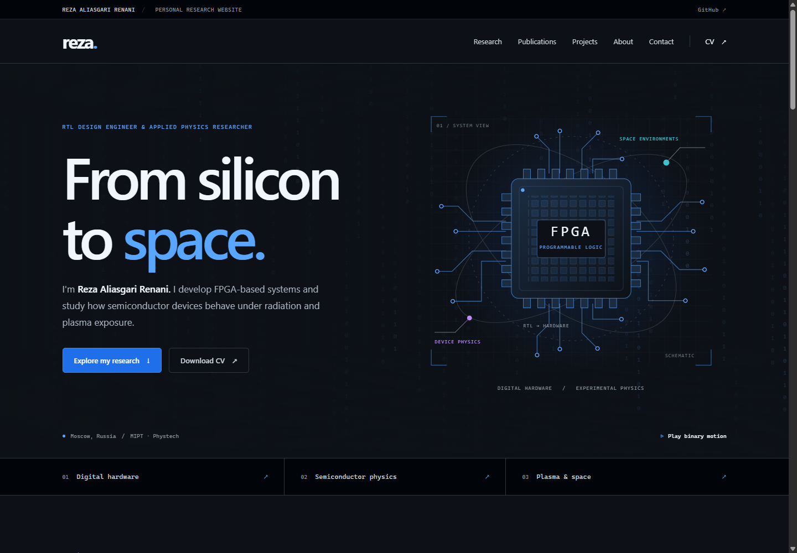

# Reza Aliasgari Renani

Personal research website: **https://rezaaliasgarirenani.github.io/**

Plain HTML, CSS, and JavaScript, with the GitHub Dark Colorblind VS Code palette, topic-based navigation, and an optional animated binary background. No front-end framework, bundler, external fonts, or JavaScript packages are needed.



[Mobile preview](design/previews/mobile_preview.png) · [Full-page preview](design/previews/desktop_full_page.png) · [Design notes](design/design_notes.md) · [How the binary background works](design/binary_background.md)

## Project structure

```text
index.html                           Page content and semantic structure
src/
  site.css                           Layout, colors, and responsive styles
  navigation.js                      Mobile navigation and keyboard behavior
  publication_filters.js             Journal/conference filters
  binary_background.js               Original canvas animation
assets/
  favicon.svg                        Editable browser icon
  reza_aliasgari_renani_cv.pdf         Downloadable CV
  graphics/
    fpga_schematic.svg                Original hero illustration
    digital_design.svg               Original research icon
    device_physics.svg               Original research icon
    plasma_space.svg                 Original research icon
design/
  design_notes.md                    Design references and asset provenance
  binary_background.md               Algorithm, coordinates, and parameters
  theme_palette.json                 Export of the actual CSS theme colors
  exports/                           PNG versions of every SVG and the canvas
  previews/                          Desktop, mobile, and full-page screenshots
documents/cv/
  reza_aliasgari_renani_cv.tex         CV layout and LaTeX preamble
  cv_body.tex                        Editable CV content
  README.md                          CV source/build notes
scripts/
  build_site.py                      Copy only runtime files into dist/
  browser_tools.py                   Shared normal Chrome setup
  check_site.py                      Browser behavior and deployment checks
  export_assets.py                   Re-create PNG exports and previews
tests/test_build_site.py             Deployment isolation and rebuild tests
.github/workflows/deploy_pages.yml   Verify, stage, and deploy GitHub Pages
requirements_dev.txt                Optional browser-tool dependency
preview.ps1                         Windows local preview helper
robots.txt                          Search crawler guidance
sitemap.xml                         Canonical page URL
.nojekyll                           Serve static files directly
```

Descriptive multiword filenames use lowercase `snake_case`. Standard tool filenames such as `README.md`, `.gitignore`, and `.gitattributes` retain their conventional names.

## Preview on Windows

Open this repository in VS Code, then run in PowerShell:

```powershell
.\preview.ps1
```

Open **http://127.0.0.1:8000/** in Chrome. Keep the terminal running and press `Ctrl+C` to stop the server. The script always serves its own folder, even when invoked from another directory, so another repository's files cannot be served by mistake.

If port 8000 is already in use, use a different port:

```powershell
.\preview.ps1 -Port 8001
```

If your PowerShell policy prevents scripts, run Python directly from the repository folder:

```powershell
python -m http.server 8000 --bind 127.0.0.1 --directory .
```

## Make an edit

- Text, publications, projects, and navigation links: edit `index.html`.
- Colors and layout: edit `src/site.css`. Theme colors are defined in `:root`.
- Motion: edit `src/binary_background.js`; see the [algorithm notes](design/binary_background.md).
- Publication filters and mobile menu: edit their respective files in `src/`.
- Illustrations and icons: edit the original SVGs in `assets/graphics/` or `assets/favicon.svg`.
- CV content and typesetting: edit the two `.tex` files in `documents/cv/`.
- Downloadable CV: replace `assets/reza_aliasgari_renani_cv.pdf` using the same filename. Changes to LaTeX sources or the CV in another repository do not automatically replace this PDF.

Save, then refresh Chrome. If an old version persists, press `Ctrl+Shift+R`. Check a narrow window as well as a desktop-sized window. The animation has a pause/play control, automatically pauses when out of view, and starts still when the visitor requests reduced motion. Content and navigation also work without JavaScript.

## Publish an edit

From this repository's PowerShell terminal:

```powershell
git status
git diff
git add index.html src assets
git commit -m "Update website content"
git push origin main
```

If you changed the CV or other assets, explicitly add those files before committing too, for example:

```powershell
git add assets/reza_aliasgari_renani_cv.pdf
```

GitHub Actions verifies and deploys website changes pushed to `main`. Check **Actions → Verify and deploy website** for progress, then refresh the public address. Runtime files are served directly, without a front-end compilation step. The Python staging script simply copies them into `dist/`.

## What is deployed?

| Included on the website | Available in GitHub, excluded from the website |
| --- | --- |
| `index.html`, `src/`, `assets/` | `design/`, including PNG exports and screenshots |
| `robots.txt`, `sitemap.xml`, `.nojekyll` | `documents/`, including CV LaTeX sources |
| | `scripts/`, `tests/`, README, and development configuration |

The allowlist lives in `scripts/build_site.py`. The deployment workflow uploads **only `dist/`**, rather than the repository root. The source repository itself is public, so the repository-only materials remain publicly browsable on GitHub.

Changes only to design exports, documentation, or CV LaTeX sources do not trigger a website deployment. Replace the PDF in `assets/` to publish a changed CV.

To inspect the exact deployment locally:

```powershell
python scripts/build_site.py
python -m http.server 8001 --bind 127.0.0.1 --directory dist
```

Open **http://127.0.0.1:8001/**. The generated `dist/` directory is ignored by Git. Run the staging script again after making source changes; it removes outdated files from `dist/`.

## Checks and reproducible assets

The deployment tests need only Python 3.12 or newer:

```powershell
python -m unittest discover -s tests -v
```

They check that repository-only materials stay out of the deployment, stale downloads are removed on rebuild, invalid sources preserve the previous output, and symlinks cannot expose or delete unrelated files. Symlink tests may skip on Windows when the account cannot create symlinks; they run in the Linux deployment workflow.

For browser checks and PNG exports, install the optional development dependency once:

```powershell
python -m pip install -r requirements_dev.txt
```

With the local preview running in another terminal:

```powershell
python -u scripts/check_site.py
python -u scripts/export_assets.py
```

These scripts use an installed **Google Chrome**, in a normal window with a temporary persistent profile. No incognito window, Playwright browser download, account sign-in, or access to your everyday Chrome profile is needed. Browser test output goes into ignored `artifacts/`; asset exports and reference previews go into the tracked `design/` folder. The binary preview is a snapshot of a random animation frame, so it changes on regeneration.

Check the packaged version and its exclusions with:

```powershell
python -u scripts/check_site.py --url http://127.0.0.1:8001/ --check_exclusions
```

## Content sources and design references

Research, publications, education, projects, and contact links come from Reza's profile README and CV in the adjacent `reza` repository (reviewed October 2026), cross-checked against his public GitHub profile and repositories. The downloadable PDF is the general English CV from `documents/CVR/`.

The design adapts the topic navigation and information hierarchy of [FBI.gov](https://www.fbi.gov/), the technical presentation of [Visual Studio Code](https://code.visualstudio.com/), and the research-focused organization of academic personal sites. The colors come from the locally installed GitHub Dark Colorblind theme. The FPGA illustration and binary animation are original, implemented directly in SVG and canvas; the illustration is a schematic, not measured data.

The original single-file implementation is preserved in Git history at commit [`95bedf8`](https://github.com/rezaaliasgarirenani/rezaaliasgarirenani.github.io/tree/95bedf8). The current source separates those same styles, interaction scripts, and original graphics into editable files.
